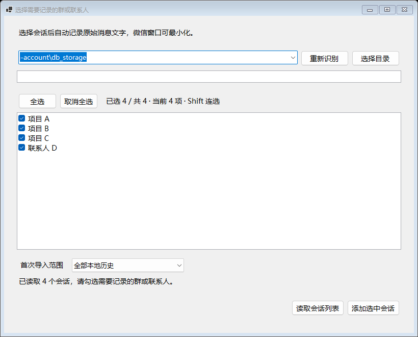
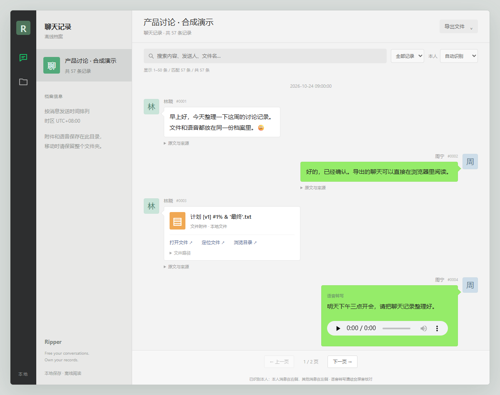

# Ripper

**Free your conversations. Own your records.**

将本机微信聊天记录导出为可独立阅读、整理和处理的文件。

Ripper 是一款 Windows 本地工具，用于记录指定微信群或联系人的聊天内容，并将文字、已下载的文件和语音整理成可以带走的聊天档案。

## 产品功能

- **按会话记录**：自动识别微信数据目录，支持多个账号、联系人和群聊。首次导入默认包含全部本地历史，也可选择最近 15 天、30 天等范围。
- **批量添加**：支持搜索会话、Shift 连选、全选和取消全选，实时显示已选数量。
- **搜索与浏览**：每个会话独立标签，支持关键词搜索、记录条数、分页、发送人、群昵称和消息来源查看。
- **本地导出**：支持导出当前会话或全部会话，生成接近微信左右气泡样式的 HTML 聊天页面，同时提供 Markdown、CSV、JSONL 文件，以及可用的附件和语音。
- **离线语音转文字**：使用本地模型识别语音，将转写文字直接放进导出的聊天记录，保留原音播放入口，支持 GPU 加速。
- **后台导出**：显示导出进度，期间可以继续切换会话、搜索和查看记录。

## 开始使用

需要 Windows 10 2004 或更新版本、x64 系统，并保持电脑上的微信已登录。推荐使用独立 EXE 发布包，无需单独安装 .NET；请完整解压并保留配套目录，双击 `Ripper.exe`。若使用 DLL 发布包，需要 .NET 10 Desktop Runtime，通过 `启动.cmd` 启动。

1. 点击 **添加会话**，确认自动识别的微信账号目录，然后点击 **读取会话列表**。未识别到时，可手动选择账号的 `db_storage` 文件夹。
2. 勾选要记录的群或联系人，选择 **首次导入范围**，点击 **添加选中会话**。
3. 点击 **开始记录**。默认每 30 秒同步一次，也可以点击 **立即采集**。记录期间微信窗口可以最小化或放在后台。
4. 在 **采集记录** 中选择会话标签，搜索关键词、翻页查看，或选中消息查看原文与来源。

### 批量选择会话

先点击一项，再按住 **Shift** 点击另一项，即可按起始项的勾选状态，连续勾选或取消中间的会话。

**全选 / 取消全选** 仅作用于当前搜索结果，筛选外的勾选会保留，提交时一起添加。列表聚焦后，也可以使用 **Ctrl+A** 全选、**Ctrl+Shift+A** 取消全选。

### 管理与查找记录

- 顶部会话列表的右键菜单提供 **读取记录、搜索、移除对话**。
- 会话标签支持右键关闭；移除或关闭会话会停止该会话采集，已保存的记录仍保留，重新添加即可恢复查看。
- **消息原文 / 来源 → 定位文件** 可以在资源管理器中选中该消息已下载的普通文件附件。
- 右上角显示当前会话所属微信账号的本地头像与昵称，点击可以刷新。

## 导出聊天记录

选择一个已有记录的会话，点击 **导出当前聊天记录**，再选择保存位置。程序会创建以聊天窗口名称命名的文件夹；同名目录自动增加编号。

导出包含该会话的全部已采集记录，不受当前搜索条件或分页限制。完成后点击 **打开目录**，双击 **聊天记录.html** 即可离线阅读。

点击旁边的 **导出全部会话**，可以一次导出当前采集记录中所有有消息的会话。选择保存位置后，程序会新建 **全部会话** 文件夹，再按会话名称分别保存；同名自动编号。空会话和此前已关闭的会话不包含在内，范围以开始导出时的会话列表为准。

批量导出显示当前会话序号和处理进度，沿用 **语音转文字（离线）** 设置，期间可以继续操作主界面。单个会话失败会继续导出其余会话，完成后在 **导出结果.txt** 查看各会话的结果与目录。关闭程序时会等待导出完成。

| 文件 | 用途 |
| --- | --- |
| 聊天记录.html | 在浏览器中阅读，支持搜索、分页、文件和语音筛选，以及语音播放 |
| 对话内容.md | 按时间阅读对话，保留发送人、时间和附件链接 |
| 聊天记录.md | 查看消息原文与来源信息 |
| 聊天记录.csv | 用表格软件进一步整理 |
| 聊天记录.jsonl | 用脚本或其他工具处理记录 |
| 附件 / 语音目录 | 保存成功导出的本地文件和音频 |

HTML 默认将本人消息放在右侧，其他消息放在左侧；识别不准确时，可通过页面中的 **本人** 选项调整。语音气泡保留转写文字和播放器。

页面中的 **定位文件** 可以调用本机 Ripper 打开资源管理器并选中文件。使用前先运行 Ripper 一次，浏览器询问是否打开应用时允许即可。请完整保留导出目录和 `ripper-files.json`，整体移动后仍可使用相对链接。

附件和语音需要已经保存在这台电脑上。缺失时可先在微信中下载或加载，再重新导出；图片、视频、表情和合并转发中的内嵌附件暂不提取原文件。

## 离线语音转文字

1. 打开 **设置 → 模型设置**。
2. 点击 **自动下载**，或选择提前下载好的 **Whisper Small 多语言模型 `ggml-small.bin`**，约 **488 MB（466 MiB）**。发布包不包含模型。
3. 点击 **保存并使用**，在导出工具栏勾选 **语音转文字（离线）**，然后导出会话。

模型只需下载一次，也可以从其他电脑拷贝后选择路径。识别在本机进行，不需要 API Key，不上传音频；首次自动下载模型时需要联网。

**启用 GPU 加速** 默认开启，不可用时自动回退 CPU；也可以关闭 GPU。CPU 默认同时识别 4 条语音，可在模型设置中调整为 1～8 路并发。识别期间进度条持续滚动，并显示完成条数和用时。

离线识别需要 **Windows 11 或更新版本**及 [VC++ 2022 x64 运行库](https://aka.ms/vs/17/release/vc_redist.x64.exe)。Windows 10 仍可采集记录及导出原始音频。转写可能有误，请结合原音核对。

## 本地数据与使用范围

聊天采集、导出与语音识别在本机完成。记录保存在 `%LOCALAPPDATA%/WeChatNotes/`，点击 **打开数据目录** 可以查看；已保存的记录与导出文件为本地明文，请妥善保管。

Ripper 只能读取已经同步到这台电脑的消息，无法恢复已删除且未采集的内容。当前为实验性产品，已在 Windows 微信 **4.1.15.53** 上验证，其他版本可能需要适配。本项目与微信官方无隶属关系。
